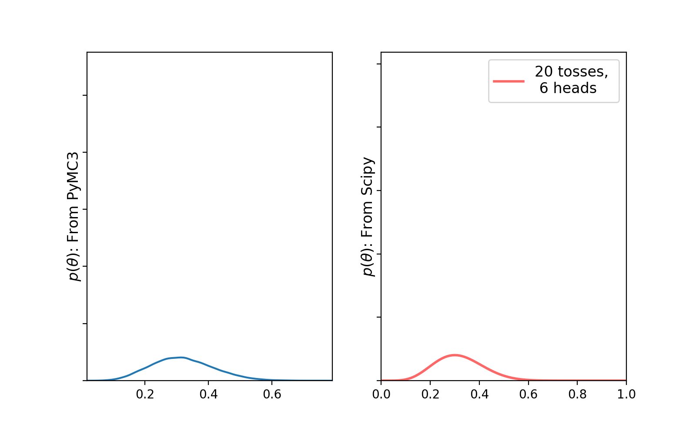
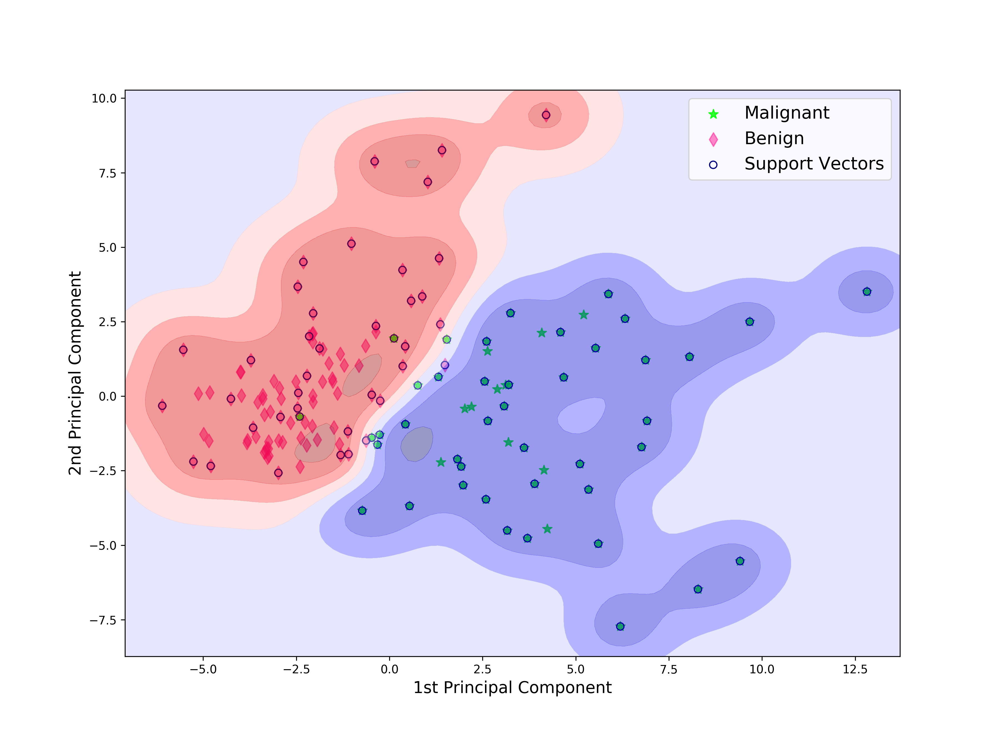

# Machine Learning and Data Analysis

Hands-on notebooks and scripts that explain some of the most important machine-learning and data-analysis techniques, from classical ML to new deep-learning ideas. Most of them come with a detailed blog post.

More descriptions are on the [Wiki](https://github.com/suvoooo/Machine_Learning/wiki). A similar repository dedicated to _Deep Learning_ is [here](https://github.com/suvoooo/Learn-TensorFlow).

#### Libraries
      

<table>
  <tr>
    <td align="center" width="50%">
      
       <b>Conjugate prior:</b> Beta posterior with PyMC3 vs SciPy
    </td>
    <td align="center" width="50%">
      
       <b>SVM:</b> decision function for malignant vs benign tumors
    </td>
  </tr>
</table>

---

## 🆕 Recent

| Topic | Description | Code | Blog | Run |
|---|---|---|---|---|
| **Kolmogorov-Arnold Networks (KAN)** | Why and how KANs work, and how they compare to MLPs. | [KAN_Intro.ipynb](KAN-Intro/KAN_Intro.ipynb) | [Medium](https://medium.com/data-science/kan-why-and-how-does-it-work-a-deep-dive-1adab4837fa3) |  |
| **AdEMAMix Optimizer** | A deep dive into AdEMAMix, a new optimizer that mixes two EMAs of the gradient. | [AdEMAMix_Concepts.ipynb](AdEMAMix_Concepts.ipynb) | [Medium](https://medium.com/data-science/ademamix-a-deep-dive-into-a-new-optimizer-for-your-deep-neural-network-6168e2c1da35) |  |

## Loss Functions & Deep Learning

| Topic | Description | Code | Blog | Run |
|---|---|---|---|---|
| **Adaptive Loss** | Description and a simple implementation of the robust and adaptive loss function ([paper by J. Barron](https://arxiv.org/pdf/1701.03077.pdf)). | [AdaptiveLoss.ipynb](AdaptiveLoss.ipynb) | [Medium](https://medium.com/@saptashwa/the-most-awesome-loss-function-172ffc106c99) |  |
| **Focal Loss** | How Focal Loss works ([paper](https://arxiv.org/abs/1708.02002)), with a TensorFlow implementation. | [FocalLoss_Ex.ipynb](FocalLoss_Ex.ipynb) | [TDS](https://towardsdatascience.com/a-loss-function-suitable-for-class-imbalanced-data-focal-loss-af1702d75d75) |  |
| **Image Augmentation with AugLy** | Examples of image augmentation using [Facebook's AugLy](https://ai.facebook.com/blog/augly-a-new-data-augmentation-library-to-help-build-more-robust-ai-models/) library. | [Augly_Try.ipynb](Augly_Try.ipynb) | [TDS](https://towardsdatascience.com/facebook-just-launched-the-coolest-augmentation-library-augly-3910c05db505) |  |

## Classical Machine Learning

| Topic | Description | Code | Blog | Run |
|---|---|---|---|---|
| **Naive Bayes ↔ Logistic Regression** | The connection between Gaussian Naive Bayes and Logistic Regression, deriving the Logistic Regression parameters from GNB. | [NB_LogisticReg.ipynb](NB_LogisticReg.ipynb) | [TDS](https://towardsdatascience.com/connecting-naive-bayes-and-logistic-regression-binary-classification-ce69e527157f) |  |
| **SVM Decision Boundary** | Pipeline + GridSearchCV to find the best SVM parameters, then decision-function contours for binary classification. | [SVM_Decision_Boundary](SVM_Decision_Boundary/) | – |  |
| **SVM Kernel Trick** | Effect of the RBF kernel mapping from 2D to 3D space. The animation requires `ffmpeg` on Unix systems. | [SVMdemo.py](SVMdemo.py) | – | – |
| **Decision Trees** | A decision tree classifier on the [Bank Marketing data set](http://archive.ics.uci.edu/ml/datasets/Bank+Marketing), plus Gini impurity explained. | [DecsTree](DecsTree/) | – |  |
| **Choosing the Best Classifier** | Data preparation and model selection for binary classification on the Pima diabetes data. | [pima_diabetes.ipynb](pima_diabetes.ipynb) | [Kaggle](https://www.kaggle.com/suvoooo/eda-and-choosing-best-classifier-on-pima-diabetes) |  |
| **Text Classification** | Classifying consumer complaints (data set described below). | [Text-classification_Complain_Suvo.py](Text-classification_Complain_Suvo.py) | – | – |
| **PCA** | Principal component analysis on the breast cancer data set. | [PCA_Muller.py](PCA_Muller.py) | – | – |
| **Ridge & Lasso Regression** | Ridge and Lasso compared with linear regression. | [RidgeandLin.py](RidgeandLin.py), [LassoandLin.py](LassoandLin.py) | – | – |
| **Pipeline + GridSearchCV** | Applying a pipeline and GridSearchCV together on the red wine data. | [pipelineWine.py](pipelineWine.py) | – | – |
| **Lagrange Multipliers** | A simple constrained optimization problem, illustrated with figures. | [lagmult.py](lagmult.py) | – | – |

## Probabilistic Models & Clustering

| Topic | Description | Code | Blog | Run |
|---|---|---|---|---|
| **Conjugate Prior** | The concept of a conjugate prior, including an introduction to [PyMC3](https://docs.pymc.io/). | [Conjugate_prior](Conjugate_prior/) | – |  |
| **Expectation Maximization** | A complete walkthrough of the Expectation Maximization algorithm. | [ExMax_ALgo](ExMax_ALgo/) | – |  |
| **DBSCAN** | Clustering weather stations in Canada with DBSCAN. | [DBSCAN_Complete](DBSCAN_Complete/) | – |  |

## Data Analysis & Wrangling

| Topic | Description | Code | Blog | Run |
|---|---|---|---|---|
| **Global Terrorism Database** | How to think about problems and interpret large-scale data using the [Global Terrorism Database](https://www.kaggle.com/START-UMD/gtd): Pandas groupby and crosstab, plus Folium and Basemap for maps. | [terrorism_kaggle.ipynb](terrorism_kaggle.ipynb) | [The Startup](https://medium.com/swlh/practical-data-analysis-using-pandas-global-terrorism-database-20b29009adad) |  |
| **Data Cleaning** | Data cleaning and outlier detection with pandas. | [datacleaning](datacleaning/) | – | – |
| **Web Scraping** | Basic web scraping, string handling and image manipulation. | [IBM_Python_Web_Scrapping.ipynb](IBM_Python_Web_Scrapping.ipynb) | – |  |

## Data Sets

| File | Description |
|---|---|
| [bank.csv](bank.csv) | Phone-call marketing of a Portuguese company's products to customers. [Description](http://archive.ics.uci.edu/ml/datasets/Bank+Marketing). |
| [gender_purchase.csv](gender_purchase.csv) | Two columns: whether customers bought a product, by gender. |
| [winequality-red.csv](winequality-red.csv) | Red wine data; the target is the `quality` column (0 to 10). |
| [Consumer_Complaints_short.csv](Consumer_Complaints_short.csv) | Three columns: complaint text, product label and category. The full file is on [data.gov](https://catalog.data.gov/dataset/consumer-complaint-database/resource/2f297213-7198-4be1-af1e-2d2623e7f6e9). |

> **Note:** some notebooks read local data files. When running them in Colab, upload the matching CSV from this repo first.

---

## License

Distributed under the Apache License. Read [`LICENSE.md`](LICENSE.md) for details.

## Contact

[Saptashwa](https://www.linkedin.com/in/saptashwa/)
